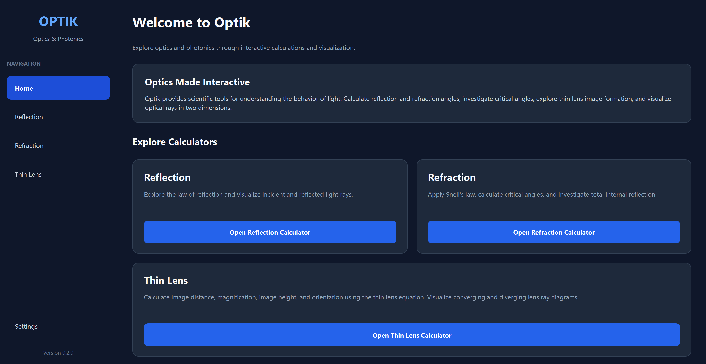
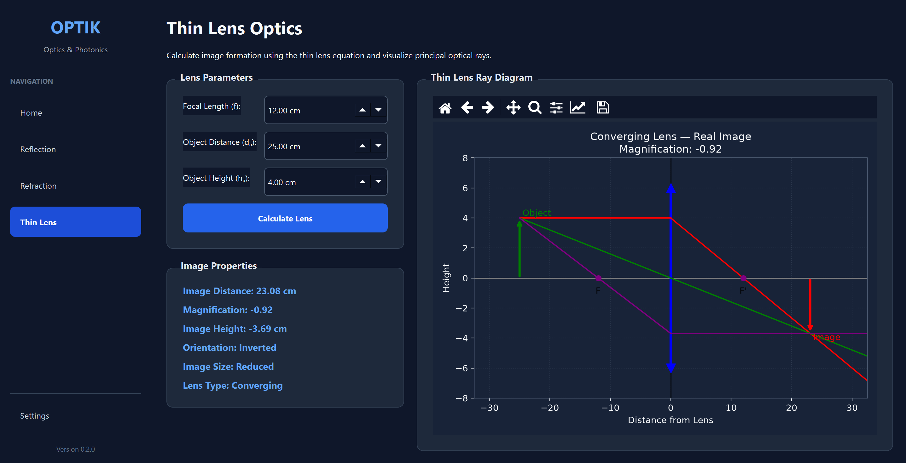

# Optik

**Open-Source Optics and Photonics Desktop Application**

**Current Version:** v0.2.0 — Thin Lens Optics  
**Programming Language:** Python  
**GUI Framework:** PySide6  
**License:** MIT

Optik is an open-source desktop application for optical calculations and scientific visualization. It provides interactive tools for exploring reflection, refraction, total internal reflection, thin lens optics, and image formation.

## Application Preview

### Home Dashboard

The Home dashboard provides access to Optik's optical calculators through a modern graphical interface.



### Thin Lens Calculator

The Thin Lens calculator supports converging and diverging lenses, image distance, magnification, image orientation, and interactive ray diagrams.



## Features

### Reflection and Refraction

- Law of reflection calculations.
- Snell's law of refraction.
- Critical-angle calculations.
- Total internal reflection detection.
- Two-dimensional ray diagrams.

### Thin Lens Optics — v0.2.0

- Converging and diverging lens calculations.
- Thin lens equation and image distance.
- Image magnification and height.
- Real and virtual image classification.
- Upright and inverted image classification.
- Enlarged, reduced, and unchanged image classification.
- Two-dimensional lens ray diagrams.

### Scientific Visualization

- Matplotlib integration with PySide6.
- Reusable Plot Manager.
- Light and Dark plotting themes.
- Interactive plot navigation.
- Figure export support for PNG, JPG, SVG, and PDF.

### Application Interface

- Sidebar navigation.
- Home dashboard.
- Dedicated calculator pages.
- Light and Dark themes.
- Persistent application settings.
- Numerical input validation.

## Thin Lens Equations

The ideal thin lens equation is:

\[
\frac{1}{f}=\frac{1}{d_o}+\frac{1}{d_i}
\]

Where `f` is focal length, `d_o` is object distance, and `d_i` is image distance.

Magnification:

\[
m=-\frac{d_i}{d_o}
\]

Image height:

\[
h_i=m h_o
\]

The application uses positive focal lengths for converging lenses and negative focal lengths for diverging lenses.

## Technologies

- Python
- PySide6
- Matplotlib
- NumPy
- SciPy
- pytest
- pytest-qt
- Git

## Installation

Clone the repository:

```bash
git clone <repository-url>
cd Optik
```

Replace `<repository-url>` with the actual GitHub repository URL.

Create a virtual environment:

```bash
python -m venv .venv
```

Activate it on Windows PowerShell:

```powershell
.venv\Scripts\Activate.ps1
```

Or on Linux/macOS:

```bash
source .venv/bin/activate
```

Install dependencies:

```bash
python -m pip install -r requirements.txt
```

Launch Optik:

```bash
python main.py
```

## Project Structure

```text
Optik/
├── main.py
├── app/
│   ├── main_window.py
│   └── config.py
├── ui/
│   ├── pages/
│   │   ├── home_page.py
│   │   ├── reflection_page.py
│   │   ├── refraction_page.py
│   │   ├── lens_page.py
│   │   └── settings_page.py
│   ├── widgets/
│   └── styles/
├── optics/
│   ├── reflection.py
│   ├── refraction.py
│   ├── snells_law.py
│   ├── total_internal_reflection.py
│   ├── thin_lens.py
│   └── magnification.py
├── visualization/
│   ├── ray_diagram.py
│   ├── lens_diagram.py
│   └── plot_manager.py
├── tests/
├── docs/
│   ├── screenshots/
│   │   ├── home_page_v0.2.png
│   │   └── thin_lens_v0.2.png
│   ├── SRS.md
│   ├── SDD.md
│   ├── USER_GUIDE.md
│   └── DEVELOPMENT.md
├── README.md
├── CHANGELOG.md
├── CONTRIBUTING.md
├── LICENSE
├── pyproject.toml
└── requirements.txt
```

## Testing

Run the complete automated test suite:

```bash
python -m pytest tests/ -v
```

Tests cover optical calculations, numerical validation, visualization, and graphical interface behavior.

## Documentation

Additional project documentation is available in the `docs/` directory:

- [Software Requirements Specification](docs/SRS.md)
- [Software Design Document](docs/SDD.md)
- [User Guide](docs/USER_GUIDE.md)
- [Development Guide](docs/DEVELOPMENT.md)
- [Changelog](CHANGELOG.md)
- [Contributing Guidelines](CONTRIBUTING.md)

## Development Roadmap

| Version | Features | Status |
|---|---|---|
| v0.1.0 | Reflection, refraction, and initial ray diagrams | Released |
| v0.2.0 | Thin lens optics, magnification, and lens diagrams | Release preparation |
| v0.3.0 | Concave and convex mirrors | Planned |
| v0.4.0 | Multiple lenses and optical systems | Planned |
| v0.5.0 | Wave optics | Planned |
| v0.6.0 | Interference and diffraction | Planned |
| v0.7.0 | Polarization | Planned |
| v0.8.0 | Optical materials and dispersion | Planned |
| v0.9.0 | Numerical and Fourier optics | Planned |
| v1.0.0 | Stable application release | Planned |

## Known Limitations

Optik currently uses idealized geometrical optics models. Thin lens calculations assume ideal lenses and paraxial rays.

Advanced diffraction, interference, polarization, aberration analysis, and complex optical systems are planned for future development.

## License

Optik is distributed under the MIT License. See [LICENSE](LICENSE) for details.